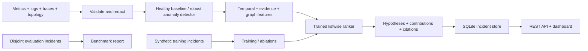

# IncidentLens

### Find the signal. Understand the incident.

[](https://github.com/Surya9918/incident-lens/actions/workflows/ci.yml)


**An evidence-backed incident investigation system that combines metrics, logs, request traces and service dependencies to rank likely root causes.**

IncidentLens detects sustained anomalies, explains each candidate's model score, and links the diagnosis to the original evidence. It includes a trained listwise ranking model, reproducible ablations, persistent incident history, a browser dashboard, a REST API, and a live HTTP fault-injection demo.

**Release scope:** a working, tested single-operator investigation application with deployment safeguards. The bundled model is trained on synthetic incidents. It is **not** validated for autonomous production remediation or arbitrary real-world workloads. See [production deployment](docs/deployment.md) and the [model card](docs/model-card.md) before using real telemetry.

## Quick start

Requires **Node.js 24.x** (tested with 24.15.0). No third-party runtime packages, Python environment, API keys or GPU are required.

```sh
git clone https://github.com/Surya9918/incident-lens.git
cd incident-lens
npm start
```

Open **http://127.0.0.1:3000**. Choose **Investigate a fault** to analyze a labeled synthetic incident, or **Healthy example** to see the detector abstain. Import a JSON telemetry file to investigate your own data.

The default server binds to loopback. Production mode requires a unique API token and an exact application origin. The dashboard keeps the token in memory, not browser storage.

## What works

| Capability | Implementation |
|---|---|
| Anomaly detection | Median/MAD robust deviation with metric-specific noise floors and three-sample persistence |
| Root-cause ranking | Trained, regularized listwise multinomial logistic model over eight features |
| Graph context | Cycle-safe traversal of caller → dependency edges and upstream anomaly coverage |
| Evidence | Real IDs of supplied error logs and failing request traces; deterministic explanations |
| Dashboard | Dependency graph, latency chart, rankings, signed feature contributions, evidence viewer, JSON import/export |
| Storage | SQLite WAL, parameterized SQL, configurable retention and incident-count limits |
| API safeguards | Bearer authentication, origin checks, payload limits, strict schemas, rate limits, safe static-file allowlist, CSP |
| Evaluation | Frozen artifacts, incident-level seed separation, metric-only and no-graph ablations |
| Live demo | Six local HTTP services, propagated database fault, telemetry capture and diagnosis |
| External data bridge | Explicit column/unit mapping for wide metrics CSV, including compatible RCAEval exports |

There is no external LLM call and no automatic execution of remediation. The explanation layer is evidence-grounded templates; it does not fabricate an LLM response. This makes the initial system reproducible and inexpensive to inspect.

## Architecture



The API never accepts root-cause labels. Synthetic truth is held outside the incident payload and displayed separately for demonstrations. Ranking weights sum to one across candidate services but **are not calibrated probabilities**. Observational correlation is not proof of causation.

## Run the live fault-injection demonstration

```sh
npm run demo:live -- --check
```

This starts six real loopback HTTP servers, sends requests through gateway → checkout → payments/inventory → database/cache, captures a healthy baseline, injects a database failure, and collects downstream symptoms. It writes:

- `data/live-incident.json` — import this into the dashboard.
- `data/live-report.json` — diagnosis and cited evidence.

The command exits unsuccessfully if the database is not ranked first. Servers are closed on completion. This is a **single-process, local network fixture**, not a Kubernetes deployment or a distributed-load benchmark. CPU is not collected in this demo and is represented by zero.

## Reproduce the experiments

```sh
npm run train
npm run evaluate
npm run verify
```

Training uses 240 complete simulated incidents (seeds 1000–1239). Evaluation uses 120 different faulty incidents and 60 healthy windows per topology. The shop topology is used in training; the chain topology is held out. Both are generated by the same simulator. No root-cause labels enter the features, and samples from one incident are not randomly split between training and test.

Committed results from [benchmark.json](docs/benchmark.json):

| Method | Shop top-1 | Chain top-1 | Shop top-3 | Chain top-3 |
|---|---:|---:|---:|---:|
| Highest metric severity | 50.0% | 62.5% | 95.8% | 95.0% |
| Learned metric features | 99.2% | 99.2% | 100% | 100% |
| Learned metrics + logs + traces, no graph | 100% | 100% | 100% | 100% |
| Full ranker | 100% | 100% | 100% | 100% |

The synthetic detector found all evaluated faults, raised no alerts in the 120 healthy windows, and had a median detection delay of two seconds at one-second sampling.

**Interpretation:** this simulator is easy and encodes relatively clean fault propagation. The graph ablation shows **no incremental accuracy benefit** here. These numbers are regression evidence, not a claim of real-world accuracy, state-of-the-art performance, or a validated causal model. External RCAEval evaluation, harder missing-telemetry cases, simultaneous faults and calibration remain open research work. Do not put an unqualified “100% accuracy” claim on a resume.

## Test and inspect

```sh
npm test
npm run test:coverage
npm run verify
```

Tests cover API lifecycle, authentication, origin rejection, rate limits, invalid and oversized input, static-file boundaries, database persistence and retention, evidence integrity, detector abstention, graph cycles, label leakage, reproducible training, and CSV conversion. `verify` also checks syntax and reproduces the committed benchmark. GitHub Actions runs on Linux and Windows and builds/smoke-tests the container.

## Analyze without the dashboard

```sh
node scripts/analyze.js data/live-incident.json
```

To import a compatible external wide metrics CSV with explicit column names and units:

```sh
node scripts/import-rcaeval.js data.csv mapping.json imported-incident.json
```

See [data contract and import guide](docs/data-contract.md). The adapter does not download datasets, invent missing telemetry, or silently treat root-cause labels as inputs. No external dataset is redistributed in this repository.

## API

| Method | Endpoint | Purpose |
|---|---|---|
| GET | `/health/live` | Process liveness; public |
| GET | `/health/ready` | Database and loaded-model readiness; public |
| GET | `/api/info` | Version and enabled features |
| POST | `/api/incidents` | Validate, analyze and persist telemetry |
| GET | `/api/incidents?limit=30&offset=0` | Paginated recent investigations |
| GET / DELETE | `/api/incidents/{id}` | Retrieve or delete one investigation |
| POST | `/api/demo` | Labeled synthetic example; disabled by default in production |
| GET | `/api/metrics` | Operational counters in Prometheus text format |

All `/api/*` routes require `Authorization: Bearer <API_TOKEN>` when a token is configured. POST bodies must be JSON and at most 2 MiB. See [API details](docs/api.md).

## Deployment

Copy `.env.example` to `.env`, set a randomly generated token and your exact origin, then:

```sh
docker compose up --build -d
```

The container runs as a non-root user with a read-only root filesystem, dropped capabilities, a writable data volume, health checks and resource limits. Compose publishes only to host loopback; put an HTTPS reverse proxy in front for remote access. Do not expose an unauthenticated development instance.

Read [deployment and backup instructions](docs/deployment.md) for token rotation, retention, rollback and capacity limits. Docker validation is performed by CI; consult the current workflow result rather than assuming a container passed because its Dockerfile exists.

## Repository map

```text
src/       validation, detection, feature extraction, training math, API, SQLite
public/    browser dashboard (no CDN assets or external scripts)
models/    frozen trained ranker and two ablation artifacts
scripts/   train, evaluate, analyze, CSV import, checks and consistent backups
demo/      HTTP service fixture and live fault-injection runner
test/      automated unit and HTTP integration tests
docs/      model card, data contract, deployment, API and benchmark results
```

## Design decisions and honest limits

- **Interpretable model first:** eight features allow every ranking score to be inspected. A GNN is a research extension, not an unsupported label on a heuristic.
- **One operator, one instance:** the shared token is not multi-tenant authorization. SQLite and synchronous inference are intended for modest incident-window workloads, not high-volume streaming.
- **Supplied healthy baseline:** at least ten baseline samples and five observation samples per service are required. A contaminated baseline reduces detector reliability.
- **Sensitive data:** pattern redaction is best-effort, not a complete secret/PII detector. Pre-sanitize telemetry and protect database files, exports and backups.
- **Unknown incidents:** multi-fault incidents, changed service graphs, unseen environments and missing modalities can invalidate scores. Investigators remain responsible for verification.

## Research extensions

1. Evaluate on externally labeled incidents with service-disjoint and chronological splits.
2. Add missing-telemetry and simultaneous-fault stress tests, confidence calibration and out-of-distribution abstention.
3. Compare temporal encoders and graph neural networks against the existing strong, cheap baselines.
4. Add an OpenTelemetry collector and streaming ingestion after establishing throughput and privacy requirements.

## References

- [RCAEval: root-cause analysis benchmark](https://github.com/phamquiluan/RCAEval) — external evaluation target; **not evaluated in the bundled results**.
- [RCAEval paper](https://arxiv.org/abs/2412.17015).
- [Loghub](https://github.com/logpai/loghub) — potential separate log-anomaly experiment; not aligned with this simulator's incidents.

MIT licensed. See [CONTRIBUTING.md](CONTRIBUTING.md) and [SECURITY.md](SECURITY.md).
